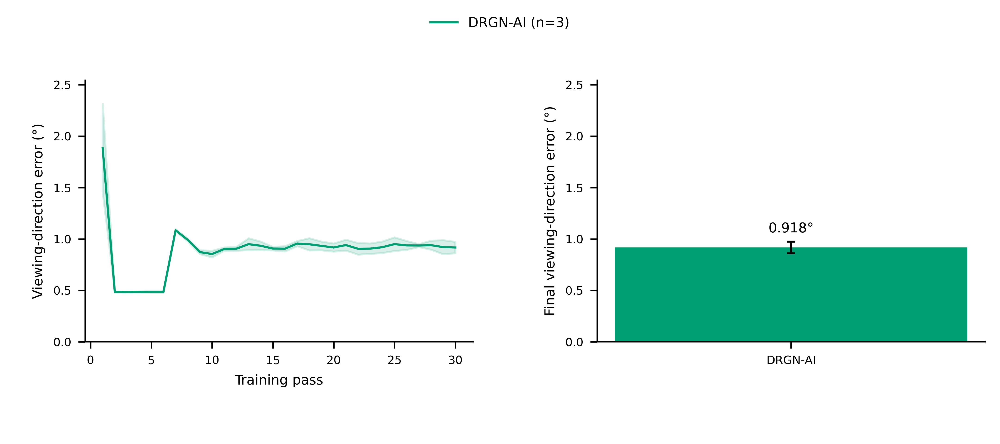
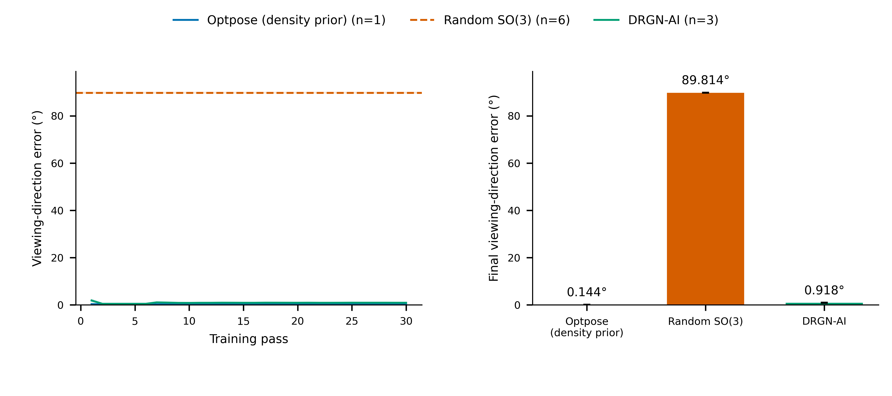

# Synthetic 80S: three complete 30-pass DRGN-AI runs

Snapshot: 2026-10-12. All 100,000 defined particles, completed seeds 0,1,2; **3/6 planned runs**. Each curve point uses the same three seeds. Remaining seeds continue on the cluster. The deposited data use fixed 15,000 Å defocus; reconciliation with the manuscript lognormal-defocus condition remains part of the strict reproduction audit.



| Method / condition | Runs | Final viewing-direction angle | Final full SO(3) angle |
| --- | ---: | ---: | ---: |
| DRGN-AI, joint density/pose learning | 3 | 0.917798 ± 0.055364° | 1.230350 ± 0.068854° |
| Optpose, fixed external density | 1 deterministic trajectory | 0.144339° | 0.153260° |
| Haar random SO(3) | 6 | 89.814062 ± 0.082625° | 126.202699 ± 0.035676° |

Mean ± sample SD across runs. Each DRGN-AI run has 100% of particles below 5° viewing-direction error. Seed 0/1/2 means are 0.979872°, 0.873518°, 0.900005°; maxima are 2.694080°, 2.318123°, 2.618704°. The fixed-density condition supplies a strong structural prior. It answers a separate conditional recovery question from joint density/pose learning.



[Full SO(3) detail](full_so3_drgnai/figure.png) · [Full SO(3) comparison](full_so3/figure.png) · [126 per-seed measurements](per_seed_metrics.csv) · [viewing-angle curve data](viewing_direction.csv) · [SO(3) curve data](full_so3.csv)

## Protocol and evidence

- DRGN-AI: 10,000-image random-pose pretraining, then 5 HPS + 25 local-optimization passes. Seed0 resumes after HPS2 on Torch 2.8/CUDA 12.8 with model/optimizer state and reset startup RNG. Seeds1/2 run from pretraining on that environment.
- Training receives particles and CTF with `pose: null`, four GT flags false, and `no_trans: false`. [Configuration audit and input hashes](status.json). All downloaded poses/configurations/logs match remote SHA256. Input images and CTF match between training and evaluation hosts.
- Evaluation: select a common coordinate frame and whole-dataset hand using the first 100 particle-derived candidate transforms, minimizing mean Frobenius norm across all particles. Viewing direction is row 3 of the rotation matrix; full SO(3) includes in-plane rotation. Truth is accessed only by the local evaluator.
- The original `pose.0.pkl` through `pose.29.pkl` are plotted as passes 1 through 30. Pretraining is recorded separately. Every fully completed run at snapshot time is included; selection follows sequential seed completion.
- [Snapshot and pose/weight SHA256](snapshot.json), `seed*/configs.yaml`, `seed*/out/drgnai-configs.yaml`, and `seed*/out/training.log` retain the run records. Full pose arrays remain in the external snapshot; weight binaries remain on the cluster. `metrics/` stores both mean-Frobenius and upstream median-squared-Frobenius alignment results, raw angles, and auxiliary raw pixel-shift norms. The latter depend on the learned volume origin.
- [Independent recomputation](qa/independent_recheck.json): atan2 viewing-angle arithmetic and relative-matrix SO(3) traces reproduce all three endpoints within 9.41e-12°. Sixty across-seed mean/SD aggregates pass independent NumPy checks. This recomputation conditions on the saved global frame/hand.
- [Visual and source QA](qa/visual_review.md): four PNG/PDF/SVG sets, 600 dpi, editable text, minimum 6 pt, passing panel alignment, 0 collision failures and 0 warnings.

## Reproduce this evaluation

Code: [snapshot collection](../../../scripts/sync_80s_results.py), [evaluation](../../../scripts/evaluate_80s_snapshot.py), [independent check](../../../scripts/recheck_80s_snapshot.py), [renderer](../../../scripts/plot_curve_endpoint.py), [metric definitions](../../../cryodyna/optpose/volume_metrics.py). Training setup and protocol differences: [80S reproduction record](../../80S_REPRODUCTION.md).

Set `SNAPSHOT` to a fresh external output directory, `EVALUATION` to another external output, `LOCAL_80S` to the prepared inputs/truth root, and `CONTROL` to the completed fixed-density control. The remote root contains `inputs/` and `seed0/` through `seed5/`. `REMOTE_PYTHON` identifies its Python executable. On this Ubuntu host, run the disk check first and launch each batch under the space guard with matching output and peak budgets.

```bash
ubuntu-space-guard check
ubuntu-space-guard run --output "$SNAPSHOT" --peak-local-gib 0.1 --peak-external-gib 2 -- \
  python scripts/sync_80s_results.py --host "$CLUSTER_HOST" \
  --remote-root "$REMOTE_80S" --remote-python "$REMOTE_PYTHON" \
  --shared-local-root "$LOCAL_80S" --output "$SNAPSHOT"
ubuntu-space-guard check
ubuntu-space-guard run --output "$EVALUATION" --peak-local-gib 0.2 --peak-external-gib 1 -- \
  python scripts/evaluate_80s_snapshot.py --snapshot "$SNAPSHOT" \
  --volume-control "$CONTROL" --output "$EVALUATION"
ubuntu-space-guard check
ubuntu-space-guard run --output "$EVALUATION/qa" --peak-local-gib 0.1 --peak-external-gib 0.2 -- \
  python scripts/recheck_80s_snapshot.py --snapshot "$SNAPSHOT" \
  --evaluation "$EVALUATION" --output "$EVALUATION/qa"
```

The archived snapshot fixes the seed cohort for this figure. A fresh later snapshot may contain additional complete seeds. The six-run completion gate and paper-fidelity gate are recorded separately from observed accuracy.
