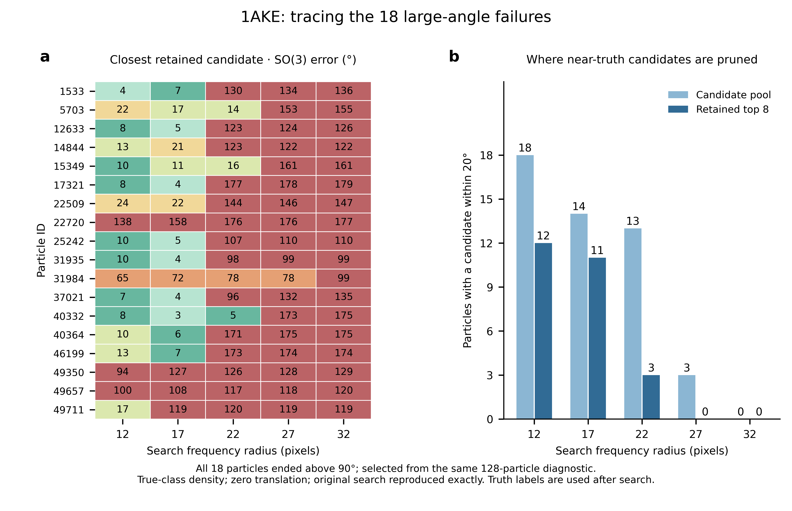

# 1AKE 大角度尾部的候选路径

2026-10-11：固定真实 class 密度、零平移的开发诊断。从锁定 128 粒子中，事后选取全部 18 个终点 SO(3) 误差超过 90° 的粒子。五阶段完整 beam 重放最大逐元素差为 0。



以完整 SO(3) 角度 ≤20° 为诊断标签：

| 频率半径 | 候选池中有近真值姿态 | 前8名中有近真值姿态 |
| --- | ---: | ---: |
| 12 | 18 | 12 |
| 17 | 14 | 11 |
| 22 | 13 | 3 |
| 27 | 3 | 0 |
| 32 | 0 | 0 |

半径22的13个命中候选池中，10个粒子在评分取前8名时丢失近真值候选；半径27时余下3个也被筛掉。该结果定位了尾部失败的筛选环节；噪声、带宽变化与多峰评分各自的贡献继续进行控制实验。粒子经过终点误差筛选，计数解释限定于这18个粒子。真实旋转在完整搜索完成后用于诊断。

源数据：[逐阶段记录](stages.csv)、[同频带父子分数](parents.csv)、[汇总](summary.json)、[冻结协议](protocol.json)。完整候选矩阵与逐候选分数保存在实验归档 `continuation_20261011/branch_trace_final/`。

源码：[搜索追踪](../../../scripts/diagnose_1ake_branches.py)、[绘图](../../../scripts/plot_1ake_branches.py)。从项目根复现，需保留前次 `output/pose_refinement_20261010/validation128` 缓存和原1AKE数据：

```bash
python scripts/diagnose_1ake_branches.py --output output/branch_trace_new
python scripts/plot_1ake_branches.py --input output/branch_trace_new
```

图导出 PNG/PDF/SVG/TIFF；版式、碰撞和字号检查通过，最小字6.4 pt。报告已纳入 `ilm/20260903.typ` 的 DRGN-AI 小节。
